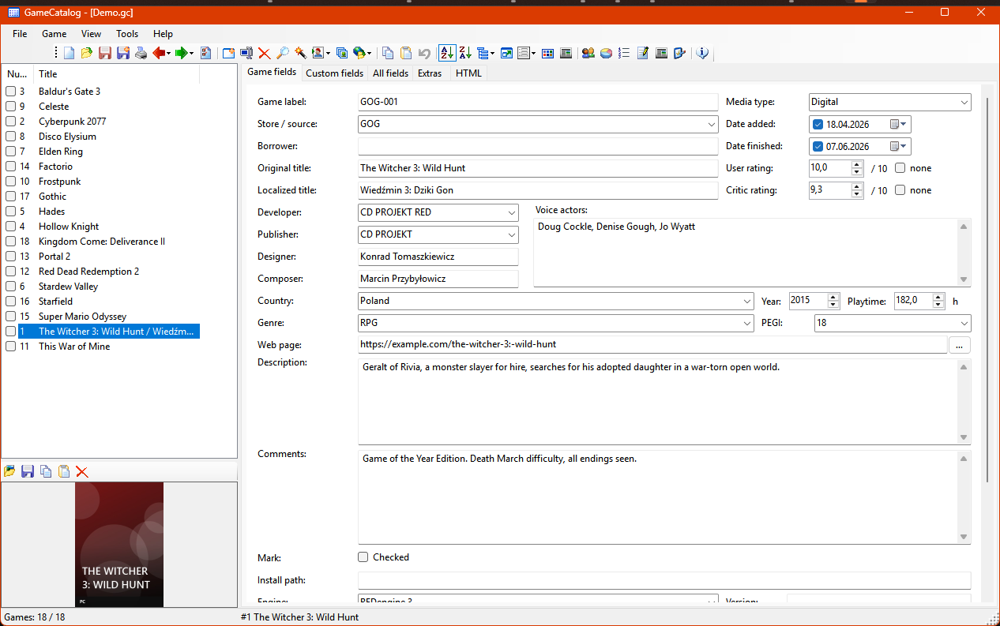
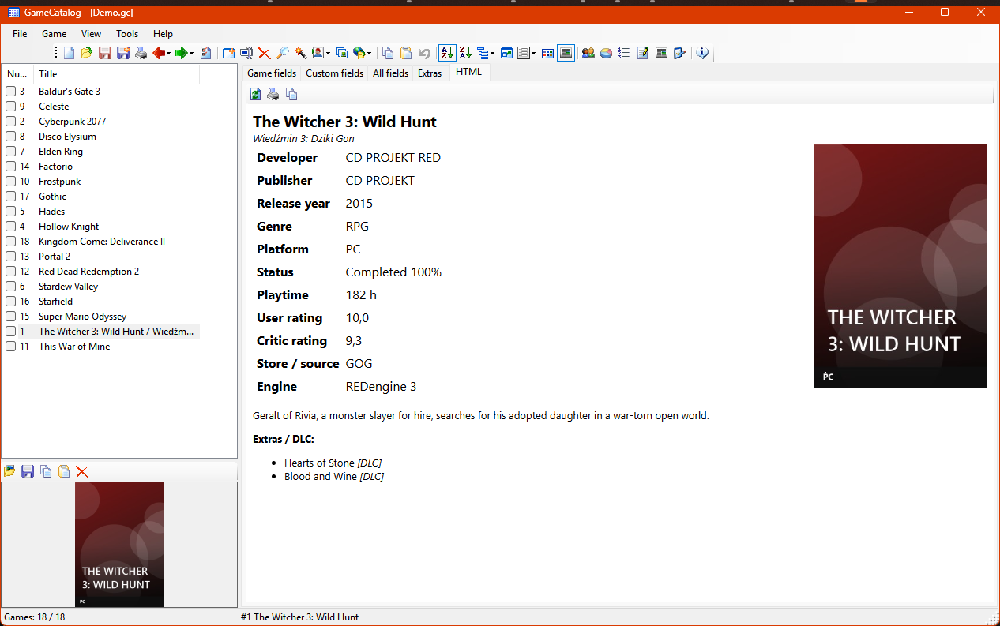
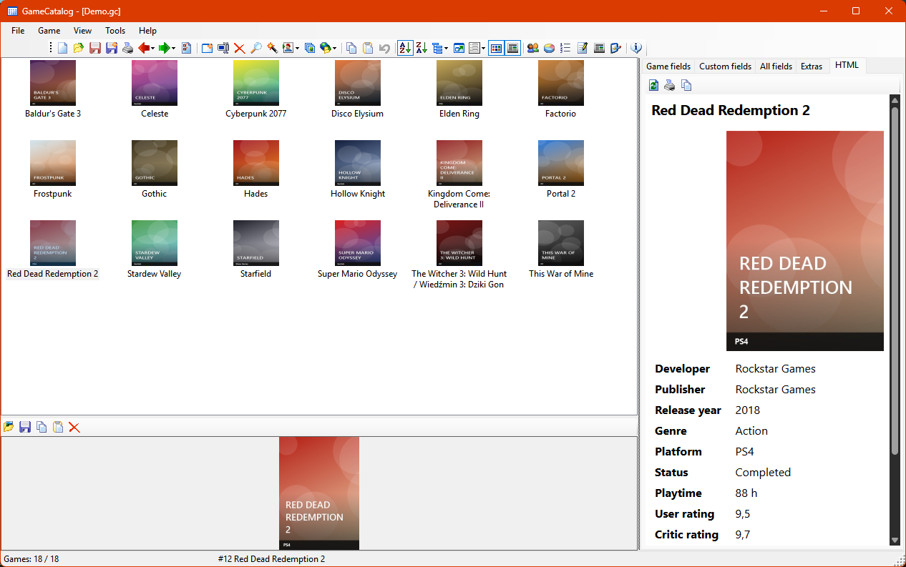

# GameCatalog

[](https://github.com/askowron/GameCatalog/actions/workflows/ci.yml)
[](https://github.com/askowron/GameCatalog/releases/latest)
[](https://github.com/askowron/GameCatalog/releases)
[](https://dotnet.microsoft.com/download/dotnet/10.0)
[](#requirements)
[](LICENSE)

A Windows desktop app for cataloguing video games. It is a C# / .NET 10 / WinForms port of
[Ant Movie Catalog](https://www.antp.be/software/moviecatalog/) (AMC), adapted from movies to games,
and it aims to look and work like AMC.

*Program do katalogowania gier wideo — port Ant Movie Catalog na C# / .NET 10 / WinForms.
Interfejs po polsku i angielsku (domyślnie język systemu).*

## Screenshots



| HTML game card | Thumbnails |
|---|---|
|  |  |

<sub>Demo catalog; the covers are generated placeholders.</sub>

## Features

- Catalogs stored as a single SQLite file (`.gc`); import of AMC XML catalogs, CSV and folders
- Game fields mapped from AMC (Developer, Publisher, Voice actors, Playtime…) plus Platform and Status
- Extras / DLC per game, cover pictures, custom fields, loans, statistics, renumbering
- AMC-style main window: list or thumbnails, grouping, sorting, HTML game card, find bar, toolbar icon themes
- Export to CSV and HTML
- C# scripts (`*.gcsx`, Roslyn) that fetch or change game data
- Plugins: importers, exporters, info providers, commands and side panels, each loaded in isolation
- Polish and English interface, switchable at runtime; translation template export for new languages

## Requirements

- Windows 10 or 11
- [.NET 10 Desktop Runtime](https://dotnet.microsoft.com/download/dotnet/10.0)
- Microsoft Edge WebView2 Runtime (for the HTML game card; included in Windows 11)

## Download

Get the latest build from [Releases](https://github.com/askowron/GameCatalog/releases), unpack it and run `GameCatalog.App.exe`.

## Building

```
dotnet build GameCatalog.slnx
dotnet test GameCatalog.slnx
dotnet run --project src/GameCatalog.App
```

Requires the .NET 10 SDK (Visual Studio 2022 17.13+ for the `.slnx` solution).

## Plugins

See [samples/GameCatalog.Plugin.Sample/README.md](samples/GameCatalog.Plugin.Sample/README.md) for how to write a plugin.

## Contributing

Bug reports, translations, scripts and pull requests are welcome; see [CONTRIBUTING.md](CONTRIBUTING.md).

## Translations

Language files live in `src/GameCatalog.App/Languages/*.json`. Use *Help → Export translation template*
to get a file with every key, translate it and drop it into the `Languages` folder.

## Author

Adam Skowroński — info@appit.pl

## License

GameCatalog is free software released under the [GNU General Public License v3.0](LICENSE).
It is based on Ant Movie Catalog by Antoine Potten, also released under the GPL.
